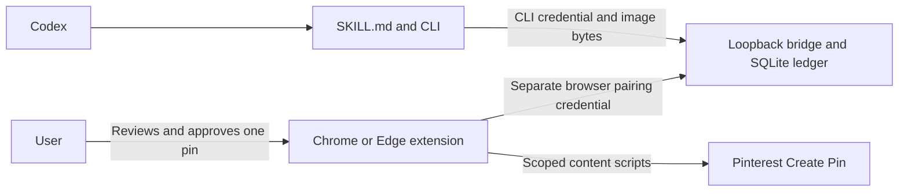

# Codex Pinterest Browser

A reusable Codex skill and Manifest V3 extension for preparing image pins in your signed-in Chrome or Microsoft Edge profile. Codex can write metadata from images it inspects or use fields you supply. The extension checks that Pinterest shows the image, fields, and selected board, then presents a preview in its own review tab. You approve each pin there.

## Architecture



- Local JPEG, PNG, and static WebP validation with a dry-run mode
- One image per pin, up to 20 entries per batch, with JSON results and browser previews
- Exact-name board selection and verification of populated metadata
- SHA-256 duplicate detection and durable pin states across bridge restarts
- One publish click per approval, with a canonical pin URL required for automated verification

## Install

1. Install Node.js 22.13 or newer and run `npm ci --omit=dev` from the project folder.
2. Load the `extension/` folder in the same profile you use for Pinterest. Use the live workflow only where Pinterest permits your automated access. [Pinterest Terms of Service, section 2(a)](https://policy.pinterest.com/en/terms-of-service)

   | Browser | Extension setup |
   | --- | --- |
   | Chrome | Open `chrome://extensions`, enable **Developer mode**, then select **Load unpacked**. |
   | Microsoft Edge | Open `edge://extensions`, enable **Developer mode**, then select **Load unpacked**. |

   [Chrome setup](https://developer.chrome.com/docs/extensions/get-started/tutorial/hello-world) · [Edge setup](https://learn.microsoft.com/en-us/microsoft-edge/extensions/getting-started/extension-sideloading)

3. Copy the extension ID shown in the manager. Sign in to Pinterest normally in that profile. In a private terminal, from the project folder, start the bridge.

   ```sh
   npm run bridge -- --extension-id YOUR_EXTENSION_ID
   ```

4. Click **Codex Pinterest Browser** in the browser's Extensions menu. Paste the bridge pairing code into the extension review tab and click **Connect**. Keep the review tab and bridge open while preparing pins. Pair again after restarting the bridge or browser.
5. For Codex discovery, place the entire `codex-pinterest-browser` folder under your repository's `.agents/skills/` or under `~/.agents/skills/` for user-wide discovery, then start a new Codex chat. If using a second checkout of the same skill, keep the registered extension path stable and run the CLI from the checkout where you installed dependencies. [OpenAI skills documentation](https://developers.openai.com/codex/skills)

## Use

Example request to Codex:

> Use $codex-pinterest-browser to inspect the images in my cycling folder, generate pin metadata, choose a suitable existing board, and prepare the pins for review.

For manual metadata, copy the example manifest and edit it for your files. The workflow guide also describes board discovery and the metadata generator for supplied image observations. Run the commands from the project folder. [Example manifest](examples/pins.json) · [Workflow guide](docs/workflow.md)

```sh
npm run pin -- scan --root "./photos"
npm run pin -- submit --root "./photos" --manifest "./pins.json" --mode dry-run
npm run pin -- submit --root "./photos" --manifest "./pins.json" --mode prepare
npm run pin -- status
```

The extension opens one Pinterest composer tab per queued pin and prepares them sequentially. When a pin is **Ready for review**, open **Preview and approval**, then review its image and all fields in the extension. **Open Pinterest draft** opens its composer tab. Return to the extension and click **Approve and publish this pin** for the specific pin you want published. See [manifest and recovery](docs/workflow.md) for modes, states, and recovery commands.

## Permissions and security

- The bridge listens on `127.0.0.1:43179`. All routes authenticate before reading a body. Browser routes also require the exact configured extension origin. Browser and CLI credentials are independent and rotate at each restart.
- The extension has session storage and host permissions for the exact Pinterest web host and loopback. Page scripts run only on the composer routes. Session cookies remain in the browser profile.
- The CLI reads an explicitly scoped local image root. The bridge accepts validated image bytes and has no API that reads a supplied local path. The content script receives bytes for its own preparation job only.
- The ledger lives under `~/.codex-pinterest-browser` by default. It retains metadata and fingerprints and holds image bytes while a pin is queued or recoverable. Use `PINTEREST_BROWSER_STATE_DIR` in both bridge and CLI to choose another private directory. Keep that directory and the pairing code private. The design trusts the local OS account and the installed extension code.
- Dry-run checks local data through the bridge and leaves the Pinterest page untouched. Preparation sends the image to Pinterest and can create an in-progress site draft. Close or remove any abandoned site drafts manually and keep the CLI ledger in sync using `discard`.
- The CLI has no publication command. The extension review UI requires a browser click and rechecks the specific composer before publishing. A same-user debugger or external browser automation can drive desktop UI. Keep the approval action human-operated.

## Troubleshooting and limitations

| What you see | What to check |
| --- | --- |
| Bridge offline or pairing rejected | Check the running bridge, the extension ID in the active browser profile, and the latest pairing code. |
| Queue stays pending | Open the paired review tab and keep it available while jobs run. Browsers can throttle background tabs. |
| `CHALLENGE` | Complete login or the security check in your browser, then retry the draft. |
| `FORM_LAYOUT`, `UPLOAD_TIMEOUT`, or `WRONG_PAGE` | Inspect the composer tab. The adapter targets the English desktop composer at `www.pinterest.com`; layouts, localized sites, and account variants can differ. |
| `BOARD_NOT_FOUND` or `AMBIGUOUS_BOARD` | Confirm the exact board name and whether it appears in the picker. Board creation, sections, and virtualized rows outside the rendered list may need manual handling. |
| `COMPOSER_NOT_CLEAN` | Inspect existing site drafts and address them manually. The extension avoids overwriting a prefilled composer. |
| `uncertain` | Check the board manually. A redirect, timeout, or error after the click can leave the result ambiguous. Use reconciliation only after finding the actual pin URL. |

Image validation accepts up to 20,000,000 bytes and 40 megapixels. Duplicate checks cover identical file bytes in this ledger, including renamed files. Re-encodes and pins created outside the ledger are outside this check. Queued drafts are tied to the current browser profile and a loaded composer tab once prepared. Layout behavior on a signed-in site requires [manual verification](docs/manual-e2e.md). Pinterest documents the desktop workflow and supported image formats. [Create a Pin](https://help.pinterest.com/en/article/create-a-pin-from-an-image-or-video) · [Pin specs](https://help.pinterest.com/en/article/review-pin-specs)

## Contributing

Install all dependencies with `npm ci`, run `npx playwright install chromium`, then run `npm run check`, `npm test`, and `npm run test:browser`. The browser suite runs the actual extension and bridge in a temporary Chromium profile against a locally mocked Pinterest page. Keep layout selectors in `extension/pinterest-adapter.js`. Add reproduction fixtures for new layouts and preserve fail-closed checks for ambiguous form and publish states. Remove account and session data from issue reports.

Licensed under [MIT](LICENSE).
